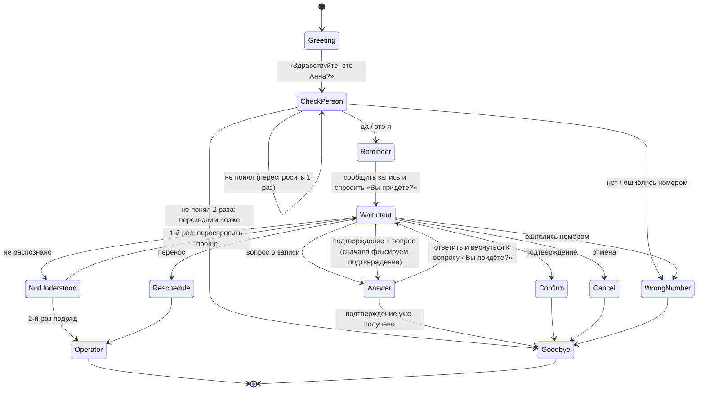

# Задача 1. Логика голосового робота-напоминания

## Входные данные

```json
{
  "appointmentId": "A-10245",
  "patientName": "Анна",
  "doctor": "Иванов Сергей Петрович",
  "specialty": "терапевт",
  "date": "2026-10-12",
  "time": "15:30",
  "clinic": "Клиника на Ленина, 15"
}
```

## Переменные сценария

| Переменная | Назначение |
|---|---|
| `fail_count` | сколько раз подряд робот не понял пациента (сбрасывается после любой распознанной реплики) |
| `question_count` | сколько вопросов уже задал пациент (защита от бесконечного разговора, лимит 3) |
| `result` | итог звонка для записи в систему клиники: `confirmed`, `cancelled`, `reschedule_request`, `wrong_number`, `no_result`, `operator` |

## Схема состояний



## Реплики и переходы

### 0. Начало звонка
1. Робот: «Здравствуйте! Это клиника на Ленина, 15. Я говорю с Анной?»
2. Если «да» → **Напоминание**.
3. Если «нет», «вы ошиблись номером», «здесь такой нет» → **Ошибка номера** (п. 7).
4. Если ответ не распознан → один раз переспросить. Если снова непонятно → данные записи **не озвучиваются** (личность не подтверждена): «Извините, перезвоним вам позже», `result = no_result`, звонок ставится на повторный набор.

**Напоминание.** «Анна, напоминаем: вы записаны к врачу Иванову Сергею Петровичу, терапевту, на 12 октября в 15:30, по адресу: Ленина, 15. Подскажите, вы придёте?»

Дальше робот классифицирует ответ по намерениям (intent).

### 1. Пациент подтверждает запись
Примеры: «да», «приду», «конечно», «буду».
- `result = confirmed`, запись в системе помечается как подтверждённая.
- Робот: «Отлично, ждём вас 12 октября в 15:30. Пожалуйста, приходите за 10 минут. До свидания!» → конец.

### 2. Пациент хочет отменить запись
Примеры: «нет, не приду», «отмените», «не смогу».
- Уточнение (защита от ошибки распознавания): «Правильно понимаю, отменить запись на 12 октября в 15:30?»
  - «да» → `result = cancelled`, запись отменяется в системе. Робот: «Запись отменена. Если захотите записаться снова, позвоните в клинику. До свидания!»
  - «нет» → вернуться к вопросу «Вы придёте?».
- Если в реплике звучит «не смогу в это время» — это скорее перенос, робот предлагает: «Хотите перенести запись на другое время?»

### 3. Пациент хочет перенести запись
Примеры: «можно перенести?», «давайте на другой день».
- `result = reschedule_request`.
- Если в системе есть API свободных слотов: робот предлагает 2–3 ближайших времени, пациент выбирает, робот подтверждает новое время и отменяет старое.
- Если API нет: «Сейчас переведу вас на администратора, он подберёт удобное время» → перевод на оператора (или создание заявки на обратный звонок, если операторы заняты).

### 4. Пациент задаёт вопрос о записи
Робот отвечает только данными из записи:
| Вопрос | Ответ |
|---|---|
| «Во сколько у меня запись?» | «Ваша запись 12 октября в 15:30.» |
| «Напомните адрес клиники» | «Клиника находится по адресу: Ленина, 15.» |
| «К какому врачу?» | «К терапевту Иванову Сергею Петровичу.» |
| Вопрос вне данных (цены, анализы, подготовка) | «К сожалению, я не могу ответить на этот вопрос. Могу перевести вас на администратора.» |

После ответа робот **возвращается к основному сценарию**: «Подскажите, вы придёте?» (если подтверждения ещё не было).
`question_count += 1`; после 3 вопросов подряд без ответа на главный вопрос предлагается перевод на оператора.

### 5. Робот не понял ответ пациента
- `fail_count = 1`.
- Робот переспрашивает проще и с подсказкой вариантов: «Извините, не расслышал. Скажите, пожалуйста: вы придёте на приём, хотите отменить или перенести запись?»

### 6. Робот два раза подряд не понял пациента
- `fail_count = 2` (счётчик сбрасывается после любой понятой реплики, поэтому «подряд»).
- Робот: «Извините, мне не удаётся вас понять. Сейчас переведу вас на администратора.»
- Перевод на оператора; если оператор недоступен: `result = no_result`, звонок ставится в очередь на повторный набор или на обратный звонок администратора.
- Тишина (пациент молчит) обрабатывается так же, как непонятый ответ.

### 7. «Вы ошиблись номером»
- Робот **не называет** врача, время и адрес постороннему человеку (это персональные медицинские данные). Поэтому проверка личности идёт до напоминания.
- Робот: «Извините за беспокойство. Хорошего дня!» → конец.
- `result = wrong_number`, номер помечается в системе для проверки администратором, повторный звонок на него не делается.

### 8. «Да, приду. А какой адрес?» — несколько намерений в одной реплике
Реплика разбирается не на одно намерение, а на список: `[confirm, question:address]`.
Порядок обработки:
1. Сначала фиксируется главное действие: `result = confirmed` (чтобы подтверждение не потерялось, даже если связь оборвётся).
2. Затем робот отвечает на вопрос.
3. Повторно спрашивать «Вы придёте?» **не нужно**, подтверждение уже получено.

Робот: «Отлично, запись подтверждена. Клиника находится по адресу: Ленина, 15. Ждём вас 12 октября в 15:30. Остались ли у вас вопросы?» → если вопросов нет, прощание.

Если в одной реплике противоречие («Да, приду… хотя нет, перенесите») — берётся последнее высказанное намерение, и робот его уточняет.

## Псевдокод основного цикла

```
say(greeting)
if not is_patient(listen()): handle_wrong_number(); end

say(reminder_text(appointment))
confirmed = false
fail_count = 0

loop:
    intents = classify(listen())          # список намерений из реплики

    if intents is empty:
        fail_count += 1
        if fail_count >= 2: transfer_to_operator(); end
        say(reprompt_with_options); continue
    fail_count = 0

    if wrong_number in intents: handle_wrong_number(); end
    if confirm in intents:      confirmed = true; save_result("confirmed")
    if cancel in intents:       if ask_cancel_confirmation(): save_result("cancelled"); say(bye); end
    if reschedule in intents:   save_result("reschedule_request"); offer_slots_or_transfer(); end

    for q in questions(intents): say(answer_from_appointment(q))

    if confirmed:
        say("Остались ли у вас вопросы?")
        if no_more_questions(listen()): say(bye_confirmed); end
    else:
        say("Подскажите, вы придёте?")
```
